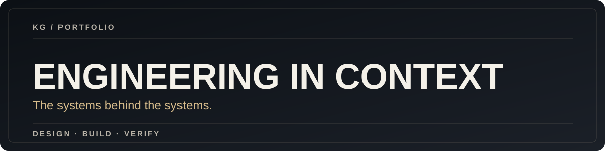

**A responsive, lightweight engineering portfolio and project index.**

[View website](https://kgeckin.github.io/) · [Selected projects](#selected-work) · [Development](#getting-started)

## Overview

This repository hosts the GitHub Pages portfolio for Kardelen Geçkin. The website introduces current infrastructure engineering experience and provides direct links to selected public projects.

## What it includes

* Responsive charcoal and champagne visual identity.
* Filterable project cards for real public GitHub projects.
* A short, expandable background section and contact links.
* Accessible focus styles and reduced-motion support.

## Selected work

The website currently links to the Inventory Portal, LinguaX, Falcon 9 Analysis and 2048. Future projects will be added only when working repositories exist.

## Getting started

Open \`index.html\` in a modern browser. No build process, package install or backend is required.

## Repository structure

~~~text
kgeckin.github.io/
├── index.html
├── docs/assets/
│   └── cover.svg
└── README.md
~~~

## Validation

No automated browser test suite is configured. Before merging, review the layout in desktop and mobile browser sizes and confirm filters, keyboard navigation, and repository links.

## Architecture & decisions

The site intentionally uses plain HTML, CSS and a few lines of JavaScript. Projects are represented by actual repository links rather than fictional dashboards. A full static site framework is not needed for the current scope.

## Security & limitations

There is no login, telemetry collector, contact form or user data processing. Linked external sites have their own privacy policies. The site is a portfolio, not an enterprise infrastructure management tool.

## License

No repository license file was found.
